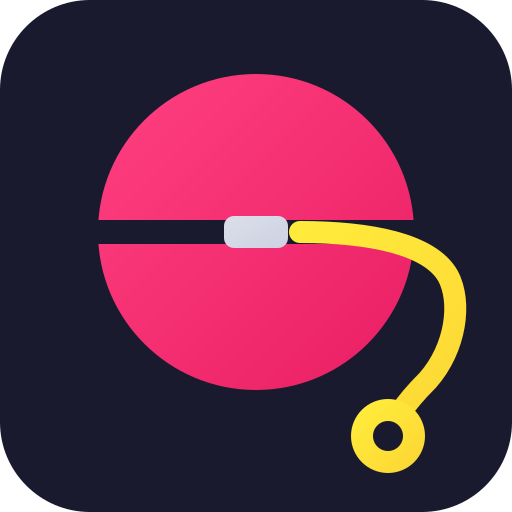

<h1 align="center">
  <a href="https://docs.codeg.app"></a> YoYoCode
</h1>

<p align="center">
  <a href="https://github.com/ijry/codeg-plus"></a>
  <a href="https://github.com/ijry/codeg-plus/releases/latest"></a>
  <a href="https://github.com/ijry/codeg-plus/releases"></a>
  <a href="../../LICENSE"></a>
  <a href="https://docs.codeg.app"></a>
  <a href="https://docs.codeg.app/getting-started/installation"></a>
</p>

<p align="center">
  <sub><a href="../../README.md">English</a> · <a href="./README.zh-CN.md">简体中文</a> · <a href="./README.zh-TW.md">繁體中文</a> · <a href="./README.ja.md">日本語</a> · <a href="./README.ko.md">한국어</a> · <a href="./README.es.md">Español</a> · <a href="./README.de.md">Deutsch</a> · <strong>Français</strong> · <a href="./README.pt.md">Português</a> · <a href="./README.ar.md">العربية</a></sub>
</p>

<p align="center">
  <strong>L'espace de travail de programmation multi-agents.</strong><br/>
  Faites tourner tous vos agents de codage IA au même endroit — et laissez-les travailler ensemble.
</p>

<h3 align="center"><a href="https://github.com/ijry/codeg-plus/releases/latest"><ins>Télécharger YoYoCode</ins></a> · <a href="https://docs.codeg.app"><ins>Documentation</ins></a></h3>

<p align="center">
  <picture>
    <source media="(prefers-color-scheme: dark)" srcset="../images/workspace-dark.png" />
    
  </picture>
</p>

<table>
  <tr>
    <td width="50%" valign="top">🧩 <strong>Une interface pour tous les agents</strong><br/>Vingt agents intégrés, et tout agent ACP peut s'y ajouter — tous affichés sous la même forme de conversation structurée, pas dans un terminal.</td>
    <td width="50%" valign="top">🔎 <strong>Des sessions qui voyagent</strong><br/>Importez, fouillez et reprenez l'historique que chaque agent conserve sur le disque, puis confiez-le à un autre agent.</td>
  </tr>
  <tr>
    <td width="50%" valign="top">🤝 <strong>Des agents qui travaillent ensemble</strong><br/>Déléguez d'un agent à l'autre avec un <code>@</code>, ou mettez en file des tâches à faire qui s'exécutent sans surveillance dans leurs propres worktrees.</td>
    <td width="50%" valign="top">🌍 <strong>Où que vous travailliez</strong><br/>Application de bureau, serveur auto-hébergé ou Docker, iPhone, iPad et Android — et Telegram, Lark ou WeChat.</td>
  </tr>
</table>

## ✨ Fonctionnalités

<table>
<tr>
<td width="50%" valign="middle">

### Une interface pour tous les agents

20 agents intégrés et tout agent ACP, dans un même chat avec cartes d'outils, diffs et réponses interactives.

[Documentation →](https://docs.codeg.app/guide/supported-agents) · [Agents personnalisés →](https://docs.codeg.app/guide/custom-agents) · [Rendu d'interface →](https://docs.codeg.app/guide/skills#cards-tables-and-charts-in-replies)

</td>
<td width="50%">
<picture>
  <source media="(prefers-color-scheme: dark)" srcset="../images/features/agents-dark.gif" />
  
</picture>
</td>
</tr>
<tr>
<td width="50%" valign="middle">

### Chaque session, à portée de recherche

Importez, recherchez et reprenez vos sessions. Partagez-les avec `@` et classez-les par étiquettes.

[Documentation →](https://docs.codeg.app/guide/aggregation) · [Étiquettes →](https://docs.codeg.app/guide/workspace#tag-conversations)

</td>
<td width="50%">
<picture>
  <source media="(prefers-color-scheme: dark)" srcset="../images/features/sessions-dark.gif" />
  
</picture>
</td>
</tr>
<tr>
<td width="50%" valign="middle">

### Collaboration multi-agents

Déléguez avec `@`. Les agents travaillent en parallèle et leurs progrès s'affichent dans votre conversation.

[Documentation →](https://docs.codeg.app/guide/multi-agent)

</td>
<td width="50%">
<picture>
  <source media="(prefers-color-scheme: dark)" srcset="../images/features/multi-agent-dark.gif" />
  
</picture>
</td>
</tr>
<tr>
<td width="50%" valign="middle">

### Des tâches à faire exécutées sans surveillance

Planifiez des tâches dans des worktrees dédiés. Les agents travaillent, vous validez les modifications.

[Documentation →](https://docs.codeg.app/guide/tasks) · [Traitement automatique →](https://docs.codeg.app/guide/repository#let-it-pick-items-up-by-itself)

</td>
<td width="50%">
<picture>
  <source media="(prefers-color-scheme: dark)" srcset="../images/features/todos-dark.gif" />
  
</picture>
</td>
</tr>
<tr>
<td width="50%" valign="middle">

### Canevas infini

Disposez chats, fichiers, terminaux et notes sur un canevas infini. Gardez tous vos agents en vue.

[Documentation →](https://docs.codeg.app/guide/canvas)

</td>
<td width="50%">
<picture>
  <source media="(prefers-color-scheme: dark)" srcset="../images/features/canvas-dark.gif" />
  
</picture>
</td>
</tr>
<tr>
<td width="50%" valign="middle">

### Bureau, serveur, mobile et chat

Bureau, serveur, Docker ou mobile : retrouvez aussi vos agents sur Telegram, Lark et WeChat.

[Documentation →](https://docs.codeg.app/getting-started/deployment) · [Espaces de travail distants →](https://docs.codeg.app/guide/workspace#desktop-and-browser) · [Applications mobiles →](https://docs.codeg.app/getting-started/installation#mobile-apps) · [Canaux de chat →](https://docs.codeg.app/guide/chat-channels)

</td>
<td width="50%">
<picture>
  <source media="(prefers-color-scheme: dark)" srcset="../images/features/anywhere-dark.gif" />
  
</picture>
</td>
</tr>
<tr>
<td width="50%" valign="middle">

### Documents Office et recherche

Créez des fichiers Office avec aperçu en direct et ouvrez des PDF. Des skills de recherche pour chaque agent.

[Documentation →](https://docs.codeg.app/guide/office) · [Recherche →](https://docs.codeg.app/guide/research)

</td>
<td width="50%">
<picture>
  <source media="(prefers-color-scheme: dark)" srcset="../images/features/office-dark.gif" />
  
</picture>
</td>
</tr>
<tr>
<td width="50%" valign="middle">

### Utilisation du navigateur et de l'ordinateur

Partagez pages et erreurs du navigateur de bureau. Computer Use (aperçu) pilote les fenêtres partagées.

[Documentation →](https://docs.codeg.app/guide/browser) · [Utilisation de l'ordinateur →](https://docs.codeg.app/guide/computer-use)

</td>
<td width="50%">
<picture>
  <source media="(prefers-color-scheme: dark)" srcset="../images/features/browser-dark.gif" />
  
</picture>
</td>
</tr>
<tr>
<td width="50%" valign="middle">

### Ligne de commande et CI

`codeg-cli` relie scripts et CI à un YoYoCode déjà lancé et affiche les réponses ou événements JSON.

[Documentation →](https://docs.codeg.app/guide/command-line)

</td>
<td width="50%" valign="middle">

```bash
codeg-cli -a codex \
  -p "Review the latest commit"

git diff | codeg-cli -a codex \
  -p "Review this diff"
```

</td>
</tr>
</table>

**Également inclus :**

- **[Toute la boucle d'ingénierie](https://docs.codeg.app/guide/workspace)** — éditeur de code, diffs en direct, [Git et worktrees](https://docs.codeg.app/guide/git), éditeur de fusion à trois volets, terminaux et vues partagées
- **[Panneau du dépôt](https://docs.codeg.app/guide/repository)** — issues, pull requests, vérifications et fusions pour GitHub, GitLab, Gitea et Forgejo ; toute issue ou PR peut devenir une tâche à faire
- **[Automatisations](https://docs.codeg.app/guide/automations)** — enregistrez une zone de saisie configurée et exécutez-la sans interface, selon une planification cron ou à la demande
- **[Utilisation des tokens](https://docs.codeg.app/guide/token-usage)** — tendances, taux de succès du cache, carte de chaleur d'activité, utilisation par dossier, agent, modèle et session, et ce que cela coûterait aux prix catalogue de l'API
- **[Bifurquer et réorienter](https://docs.codeg.app/guide/workspace#follow-along-%E2%80%94-the-conversation)** — sur les agents qui le prennent en charge, faites bifurquer une conversation depuis une réponse terminée, ou envoyez un message dans un tour encore en cours
- **[Compétences](https://docs.codeg.app/guide/skills) et [MCP](https://docs.codeg.app/guide/mcp)** — packs de compétences par agent, scan MCP local, recherche et installation depuis le registre
- **[Lanceur de projet](https://docs.codeg.app/guide/project-boot)** — créez visuellement le squelette d'un nouveau projet, avec un aperçu en direct
- **[Notifications](https://docs.codeg.app/reference/settings/general#desktop-notifications)** — notifications du bureau, sons, et un bouton de barre des tâches qui clignote ou une icône du Dock qui rebondit quand un tour se termine ou qu'un agent a besoin de vous
- **[À votre image](https://docs.codeg.app/reference/settings/appearance)** — douze thèmes que vous pouvez recolorer token par token, fonds d'écran, rayon des coins, largeur du chat, CSS personnalisé et une mascotte de bureau — dans n'importe laquelle des dix langues de l'interface
- **[Sauvegarde et synchronisation](https://docs.codeg.app/reference/settings/system#backup-restore)** — sauvegardes chiffrées et synchronisation de la configuration entre machines, via un fichier ou votre propre serveur WebDAV
- **[Schéma d'URL](../../docs/url-scheme.md)** — `codeg://session/<id>` ouvre une conversation depuis une autre application (bureau)
- **Et plus encore** — presque chaque version apporte du nouveau ; les [notes de version](https://github.com/ijry/codeg-plus/releases) en donnent la liste complète

## 🤖 Agents pris en charge

YoYoCode communique avec chaque agent via l'[Agent Client Protocol](https://agentclientprotocol.com) : chacun bénéficie ainsi de la même interface structurée. Vingt sont intégrés, et YoYoCode installe, épingle et met à jour la plupart d'entre eux pour vous :

<p>
  <a href="https://www.anthropic.com/claude-code"><kbd> Claude Code</kbd></a> &nbsp;
  <a href="https://github.com/openai/codex"><kbd> Codex</kbd></a> &nbsp;
  <a href="https://github.com/google-gemini/gemini-cli"><kbd> Gemini CLI</kbd></a> &nbsp;
  <a href="https://openclaw.ai"><kbd> OpenClaw</kbd></a> &nbsp;
  <a href="https://opencode.ai"><kbd><picture><source media="(prefers-color-scheme: dark)" srcset="../images/agents/opencode-dark.svg" /></picture> OpenCode</kbd></a> &nbsp;
  <a href="https://cline.bot"><kbd><picture><source media="(prefers-color-scheme: dark)" srcset="../images/agents/cline-dark.svg" /></picture> Cline</kbd></a> &nbsp;
  <a href="https://hermes-agent.nousresearch.com"><kbd><picture><source media="(prefers-color-scheme: dark)" srcset="../images/agents/hermes-agent-dark.svg" /></picture> Hermes Agent</kbd></a> &nbsp;
  <a href="https://www.codebuddy.ai"><kbd><picture><source media="(prefers-color-scheme: dark)" srcset="../images/agents/codebuddy-dark.svg" /></picture> CodeBuddy</kbd></a> &nbsp;
  <a href="https://www.kimi.com/code"><kbd> Kimi Code</kbd></a> &nbsp;
  <a href="../agents/minimax-code.md"><kbd> MiniMax Code</kbd></a> &nbsp;
  <a href="https://pi.dev"><kbd> Pi</kbd></a> &nbsp;
  <a href="https://x.ai/cli"><kbd><picture><source media="(prefers-color-scheme: dark)" srcset="../images/agents/grok-dark.svg" /></picture> Grok</kbd></a> &nbsp;
  <a href="https://cursor.com/cli"><kbd><picture><source media="(prefers-color-scheme: dark)" srcset="../images/agents/cursor-dark.svg" /></picture> Cursor</kbd></a> &nbsp;
  <a href="https://deepseek-harness.github.io/deepseek-harness/"><kbd> DeepSeek Harness</kbd></a> &nbsp;
  <a href="https://qoder.com"><kbd><picture><source media="(prefers-color-scheme: dark)" srcset="../images/agents/qoder-dark.svg" /></picture> Qoder</kbd></a> &nbsp;
  <a href="https://antigravity.google"><kbd><picture><source media="(prefers-color-scheme: dark)" srcset="../images/agents/google-antigravity-dark.svg" /></picture> Google Antigravity</kbd></a> &nbsp;
  <a href="https://kiro.dev/cli/"><kbd> Kiro CLI</kbd></a> &nbsp;
  <a href="../agents/zcode.md"><kbd> ZCode</kbd></a> &nbsp;
  <a href="https://docs.trae.cn/cli_about-trae-code-cli-2"><kbd> TRAE CLI</kbd></a> &nbsp;
  <a href="https://commandcode.ai"><kbd> Command Code</kbd></a> &nbsp;
  <a href="https://docs.codeg.app/guide/custom-agents"><kbd>+ tout agent ACP</kbd></a>
</p>

Pas dans la liste ? Choisissez n'importe quel agent dans le registre public ACP ou collez son JSON de distribution — YoYoCode l'installe, vérifie qu'il démarre et le traite comme un agent intégré. Prérequis d'exécution et emplacement des sessions de chaque agent : [Agents pris en charge](https://docs.codeg.app/guide/supported-agents).

## 📦 Installation

**Bureau** — les installateurs pour macOS, Windows et Linux se trouvent dans les [Releases](https://github.com/ijry/codeg-plus/releases/latest) ; les étapes de mise en place sont dans [Installation](https://docs.codeg.app/getting-started/installation).

**Serveur** — faites tourner YoYoCode sans interface et accédez-y depuis n'importe quel navigateur. Sous Linux ou macOS :

```bash
curl -fsSL https://raw.githubusercontent.com/ijry/codeg-plus/main/install.sh | bash
CODEG_STATIC_DIR=/usr/local/share/codeg/web codeg-server
```

Sous Windows, dans PowerShell :

```powershell
irm https://raw.githubusercontent.com/ijry/codeg-plus/main/install.ps1 | iex
$env:CODEG_STATIC_DIR="$env:LOCALAPPDATA\codeg-server\web"; codeg-server
```

**Docker** — le même serveur, dans un conteneur :

```bash
docker run -d -p 3080:3080 -v codeg-data:/data ghcr.io/ijry/codeg-plus:latest
```

Dans les deux cas, ouvrez `http://<host>:3080` dans un navigateur et saisissez le jeton d'accès que le serveur affiche au démarrage (pour le conteneur, `docker logs` le montre), ou définissez `CODEG_TOKEN` pour choisir le vôtre.

**Mobile** — installez l'[app iOS](https://apps.apple.com/app/codeg-client/id6785199071) ou l'[APK Android](https://github.com/xintaofei/codeg-android/releases/latest), puis pointez-la vers le **Service Web** de votre application de bureau ou vers votre propre `codeg-server` : URL, jeton, c'est prêt. Les étapes d'appairage sont dans [Applications mobiles](https://docs.codeg.app/getting-started/installation#mobile-apps).

Compose, binaires précompilés, compilation depuis les sources et mises à jour sur place sont traités dans [Déploiement](https://docs.codeg.app/getting-started/deployment) ; les variables d'environnement dans [Configuration](https://docs.codeg.app/getting-started/configuration).

## 👥 Communauté et support

- **WeChat** — scannez le QR code et rejoignez notre groupe pour des discussions, des retours et des mises à jour :

  <picture>
    <source media="(prefers-color-scheme: dark)" srcset="../images/weixin-dark.jpg" />
    
  </picture>

- **Issues** — un bug trouvé ou une fonctionnalité manquante ? [Ouvrez une issue](https://github.com/ijry/codeg-plus/issues).
- **Confidentialité** — local d'abord : l'analyse, le stockage et les opérations sur les projets restent sur votre machine, et les modes web et serveur sont protégés par une authentification par jeton. Détails dans [Confidentialité et sécurité](https://docs.codeg.app/reference/privacy).
- **LinuxDO** — merci à la communauté [LinuxDO](https://linux.do) pour son soutien.
- **Soutenez-nous** — [mettez une étoile au dépôt](https://github.com/ijry/codeg-plus) pour suivre le projet.

## 🤝 Contribuer

Les issues et les pull requests sont les bienvenues. Pour compiler YoYoCode vous-même, commencez par [Développement](https://docs.codeg.app/reference/development) et [Architecture](https://docs.codeg.app/reference/architecture).

<a href="https://github.com/ijry/codeg-plus/graphs/contributors">
  
</a>

## ⭐ Historique des étoiles

<a href="https://www.star-history.com/?repos=ijry%2Fcodeg-plus&type=date&releases=&legend=bottom-right">
 <picture>
   <source media="(prefers-color-scheme: dark)" srcset="https://api.star-history.com/chart?repos=ijry/codeg-plus&type=date&theme=dark&legend=bottom-right" />
   <source media="(prefers-color-scheme: light)" srcset="https://api.star-history.com/chart?repos=ijry/codeg-plus&type=date&legend=bottom-right" />
   
 </picture>
</a>

## 🙏 Remerciements

- [Agent Client Protocol](https://agentclientprotocol.com) — le socle qui permet à YoYoCode de se connecter à tous les agents qu'il supporte
- [Superpowers](https://github.com/obra/superpowers) — alimente le module de compétences d'experts de YoYoCode
- [OfficeCLI](https://github.com/iOfficeAI/OfficeCLI) — alimente le flux de travail des documents Office de YoYoCode
- [scientific-agent-skills](https://github.com/K-Dense-AI/scientific-agent-skills) — alimente les compétences de Recherche scientifique de YoYoCode (sous-ensemble sous licence MIT)
- [json-render](https://github.com/vercel-labs/json-render) — alimente les cartes, tableaux et graphiques du Rendu d'interface de YoYoCode
- [cua-driver](https://github.com/trycua/cua) — alimente l'Utilisation de l'ordinateur de YoYoCode

## 📜 Licence

Apache-2.0. Voir [LICENSE](../../LICENSE).
